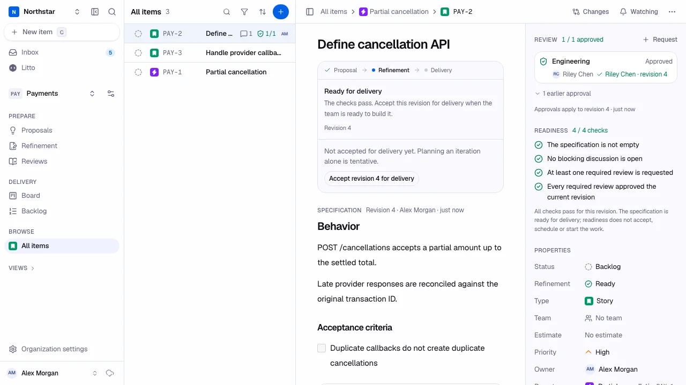
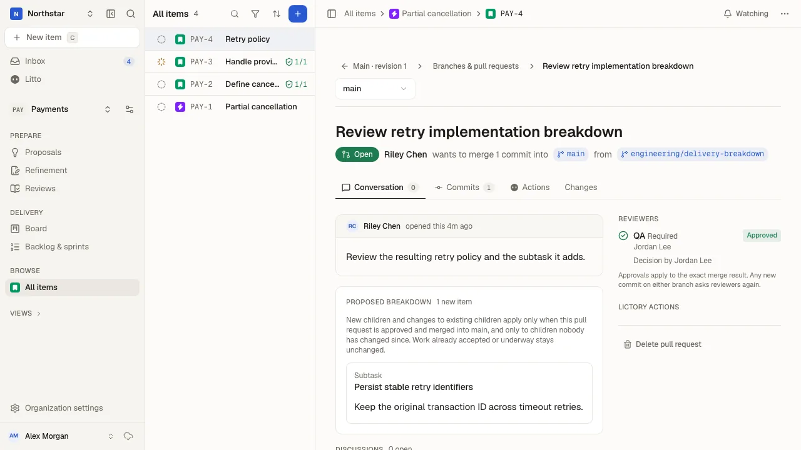
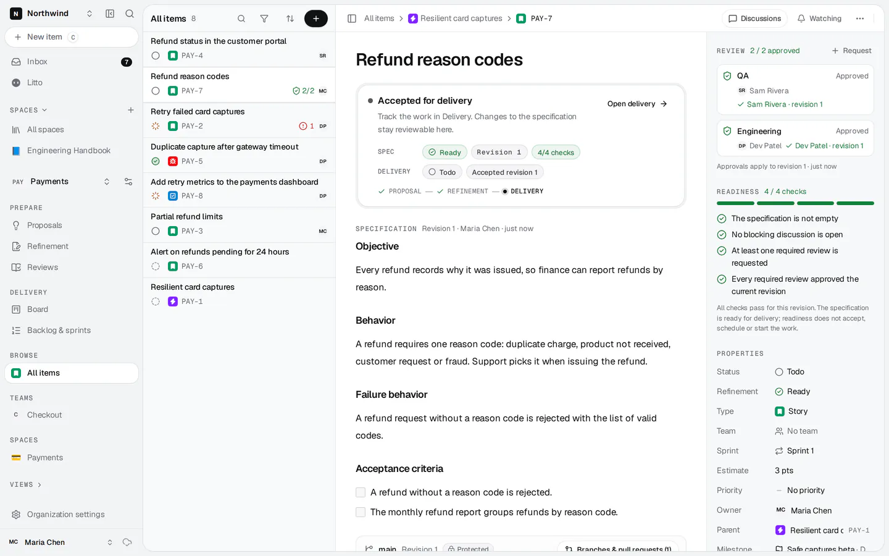

<p align="center">
  
</p>

<h1 align="center">Agree on what to build. Then ship it.</h1>

<p align="center">
  Open-source work management for software teams, with requirements reviewed like code.
</p>

<p align="center">
  <a href="https://lictory.com">Website</a> ·
  <a href="https://docs.lictory.com">Documentation</a> ·
  <a href="https://docs.lictory.com/self-hosting/install">Install</a> ·
  <a href="https://github.com/chricarp/lictory/releases">Releases</a> ·
  <a href="CONTRIBUTING.md">Contribute</a>
</p>

Lictory helps Product, Engineering and QA turn rough proposals into specifications
that a team can safely commit to. Review the behavior, discuss the exact text,
propose changes on branches and approve a specific revision. Then deliver the
work in Lictory or hand it off to Jira Cloud.

Self-hosted. MIT licensed. Core collaboration works without AI or analytics.

## See how it works

### Refine the specification together



The specification stays in the center. The right panel shows who reviewed which
revision and the evidence behind readiness. **Ready for delivery** is separate
from **Accept revision 4 for delivery**: agreeing that the behavior is clear does
not commit the team to building it. Material edits make earlier approvals stale.

### Review changes and the delivery breakdown



Branches let teammates and agents propose changes without overwriting the agreed
specification. Review the resulting text and proposed child work together;
approvals and unresolved blockers gate merging. Discussions and history stay
attached to the revision or change they describe.

### Keep the agreement visible during delivery



Accepting a revision records what the team agreed to build. Later edits remain
reviewable, and completing work records the delivered revision. Each project
chooses its delivery owner:

- **In Lictory:** custom work item types and statuses, ranked boards and backlogs,
  teams, sprints or automatic cycles, estimates, burndown, velocity and relations.
- **In Jira Cloud:** publish ready work, update it explicitly after changes and
  read Jira's delivery status back. Jira owns delivery status and assignment.

Screenshots show the application with fictional data. See the
[team guide](https://docs.lictory.com/getting-started) for the complete workflow.

## Install on your server

Use a Linux server (amd64 or arm64) with Docker Engine 25+ and Compose 2.24+,
a host name and at least 2 GB RAM (4 GB recommended). For automatic HTTPS,
point DNS at the server and open ports 80 and 443.

```sh
curl -fsSL https://raw.githubusercontent.com/chricarp/lictory/main/deploy/get.sh | sudo sh
sudo lictory install
```

The terminal guides you through server checks, the address and certificates,
email, attachments, SSO, backups, access policy and the first administrator.
Use **↑/↓** or **j/k** to choose and **Enter** to confirm. Before applying
configuration, the installer shows a summary with secrets masked; progress and
failure logs keep long steps understandable. Re-running it preserves settings
and secrets you do not change.

SMTP or Resend enables invitations and password recovery. Attachments use an
optional S3-compatible bucket. Single sign-on supports OpenID Connect. See
[installation](https://docs.lictory.com/self-hosting/install) and
[configuration](https://docs.lictory.com/self-hosting/configuration).

### Operate from the terminal

```sh
lictory status                      # version, services and access policy
lictory doctor                      # diagnose the host and installation
lictory logs worker -f --tail 100    # follow a service's logs
sudo lictory backup                  # back up before making changes
sudo lictory upgrade                 # newest release of your configured channel
sudo lictory admin setup             # create the first administrator if deferred
```

Every command supports `--env <name>` for multiple environments. `--yes` runs
without questions; flags or `LICTORY_<FLAG>` environment variables supply install
settings. Pipes receive plain output, `NO_COLOR=1` disables styling, and
`lictory status --json` provides machine-readable status. `lictory help` and
`lictory admin help` list the commands.

The [terminal guide](https://docs.lictory.com/self-hosting/terminal) covers
unattended installation, reconfiguration, account recovery, rollback and restore
drills. The [operator runbook](docs/operations/self-hosting.md) includes every
install option.

## Work with your coding agent

Connect an MCP client to your installation's `https://<host>/api/mcp` using a
personal access token from **Account settings → AI agents (MCP)**. Give each
agent its own name, access level and expiry. The agent works with your current
permissions, and its actions are attributed to you and its token's name.

For example, ask your terminal's coding agent:

> Read PAY-142 and its unresolved discussions. Propose the missing timeout
> behavior on a branch and open a pull request for Engineering and QA to review.

Agents can read specifications, search product knowledge, propose revisions and
break down delivery work through the same domain operations as the browser.
Approving, merging, resolving discussions and publishing record human decisions
and require your explicit instruction. Account security, membership and secrets
stay in the browser.

See [connecting agents](https://docs.lictory.com/integrations/agents) for setup,
example prompts and troubleshooting. This uses your MCP client's model;
Lictory's built-in **Litto** assistant and automated Intelligence checks are
optional and require a configured OpenAI key and organization enablement.

## Develop locally

Install the Bun version in `packageManager`, Node.js 24 LTS, Docker, Git and
Bash 4+ (including on macOS for the release-tooling tests).
On Windows, use WSL2. A dev container is also included.

```sh
git clone https://github.com/chricarp/lictory.git
cd lictory
cp .env.example .env
bun install --frozen-lockfile
docker compose up -d
bun run dev
```

- App: http://localhost:3000
- Marketing website: http://localhost:3100
- Documentation: `bun run --cwd apps/docs dev`, http://localhost:3200
- Mailpit: http://localhost:8025; MinIO console: http://localhost:9001

The [development runbook](docs/operations/development.md) covers environment
settings, OAuth callbacks, database migrations, daily commands and the complete
required verification sequence.

### Repository layout

| Workspace        | Purpose                                                                |
| ---------------- | ---------------------------------------------------------------------- |
| `apps/platform`  | React + Vite application with TanStack Router and Zero synchronization |
| `apps/api`       | Hono on Node.js: authentication, capabilities, MCP, files and delivery |
| `apps/worker`    | Background email, AI, Jira exports/status sync and cycles              |
| `apps/marketing` | Static Next.js website at lictory.com                                  |
| `apps/docs`      | Static Fumadocs site at docs.lictory.com                               |
| `packages/core`  | Domain rules, contracts, Drizzle/PostgreSQL access and adapters        |
| `packages/zero`  | Synchronized projections, queries and mutations                        |
| `packages/ui`    | Shared UI, theme and assets                                            |

PostgreSQL is authoritative. Domain writes and browser projections update in one
transaction; Zero replicates the projections. Start with the
[documentation index](docs/README.md) and [product principles](AGENTS.md).

## Privacy

Telemetry is off by default. AI analysis, analytics, outbound email, object
storage, Jira and external sign-in providers contact their configured services
only when enabled. Self-hosted data stays under your control; connecting an MCP
client also gives that client's agent access to the data your token permits.
See [privacy and telemetry](https://docs.lictory.com/self-hosting/privacy).

## Contributing and support

Read [Contributing](CONTRIBUTING.md), [Governance](GOVERNANCE.md) and the
[Code of conduct](CODE_OF_CONDUCT.md). Use [Support](SUPPORT.md) for setup and
usage questions; report vulnerabilities through the
[security policy](.github/SECURITY.md).

Release notes live in [GitHub Releases](https://github.com/chricarp/lictory/releases).
See the [release runbook](docs/operations/releases.md) for versioning and stable
promotion. Lictory uses the [MIT License](LICENSE); bundled materials retain
their own [third-party notices](THIRD_PARTY_NOTICES.md).
